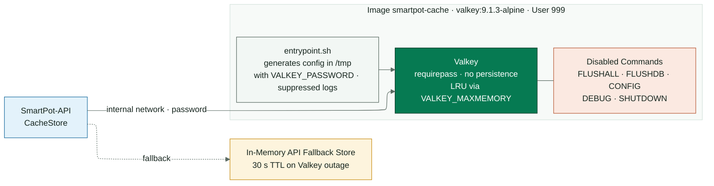

<!-- portada
eyebrow: Component Technical Documentation
titulo: SmartPot-Cache
acento: Cache
subtitulo: Hardened Valkey In-Memory Cache and Rate Limiting
bajada: Hardened Valkey cache for rate limits, agent cooldowns, AI caches, and Telegram link codes, without persistence and isolated on the internal network.
documento: SmartPot-Cache Documentation
version: 1.0 · October 2026
equipo: SmartPotTech
proyecto: smartpot.app
-->

# SmartPot-Cache

<!-- parte: PART I | Component Overview -->

## Document Sheet

| Field                  | Value                                                                                                                                                                                                                                                                                                                                                                            |
|------------------------|----------------------------------------------------------------------------------------------------------------------------------------------------------------------------------------------------------------------------------------------------------------------------------------------------------------------------------------------------------------------------------|
| Project                | SmartPot · [smartpot.app](https://smartpot.app)                                                                                                                                                                                                                                                                                                                                  |
| Component              | [SmartPot-Cache](https://github.com/SmartPotTech/SmartPot-Cache)                                                                                                                                                                                                                                                                                                                 |
| Version                | 1.0 · October 2026                                                                                                                                                                                                                                                                                                                                                               |
| Scope                  | Migration from Redis to Valkey, key catalog and TTLs, hardening, failure behavior, configuration, and smoke tests                                                                                                                                                                                                                                                                |
| Platform Documentation | [Technical Documentation](https://github.com/SmartPotTech/.github/blob/main/docs/SmartPot_Technical_Documentation.md), [Project Journey](https://github.com/SmartPotTech/.github/blob/main/docs/SmartPot_Project_Journey.md), [Software Lifecycle](https://github.com/SmartPotTech/.github/blob/main/docs/SmartPot_Software_Lifecycle.md), and [Global Diagrams](https://github.com/SmartPotTech/.github/blob/main/docs/README.md) |
| Maintenance            | Generated from `docs/` in this repository using `.github/docs/tools`; updated alongside every component change                                                                                                                                                                                                                                                                   |

## 1. Purpose

### In Simple Terms

Valkey stores short-lived data shared across API requests: how many times an IP has called an endpoint, when the latest reading arrived for a crop, when the autonomous agent last acted, and single-use codes to link Telegram. None of this is permanent: if Valkey restarts, the platform continues operating and rebuilds state on demand.

### Why Valkey Instead of Redis

Redis was the open-source cache originally used by SmartPot, but starting in version 8 it switched to restrictive source-available licenses (AGPLv3 / SSPLv2 / RSALv2). **Valkey** is the Linux Foundation fork that preserves the original open-source license (BSD-3-Clause). It speaks the exact same wire protocol (RESP), commands, and port 6379, making the transition transparent for [SmartPot-API](https://github.com/SmartPotTech/SmartPot-API): the same address, password, and client (`go-redis`). No contracts or query patterns change. The image accepts `VALKEY_PASSWORD` and, for backward compatibility, `REDIS_PASSWORD`.

## 2. Component Architecture

<!-- diagrama: SmartPot_Cache_Global_Component | titulo=SmartPot-Cache internals -->

## 3. Keys

```mermaid
%%{init: {"theme": "base", "fontFamily": "Segoe UI, Arial, sans-serif", "themeVariables": {"fontFamily": "Segoe UI, Arial, sans-serif", "fontSize": "15px", "primaryColor": "#DDF5EA", "primaryTextColor": "#17261F", "primaryBorderColor": "#067A52", "secondaryColor": "#E3F2FB", "secondaryTextColor": "#17261F", "secondaryBorderColor": "#1F6FA0", "tertiaryColor": "#F2F7F4", "tertiaryTextColor": "#17261F", "tertiaryBorderColor": "#D5E3DC", "lineColor": "#5B6B63", "textColor": "#17261F", "mainBkg": "#DDF5EA", "nodeBorder": "#067A52", "clusterBkg": "#F7FAF8", "clusterBorder": "#D5E3DC", "edgeLabelBackground": "#FFFFFF", "actorBkg": "#067A52", "actorBorder": "#0B3D2B", "actorTextColor": "#FFFFFF", "actorLineColor": "#5B6B63", "signalColor": "#17261F", "signalTextColor": "#17261F", "labelBoxBkgColor": "#0B3D2B", "labelBoxBorderColor": "#0B3D2B", "labelTextColor": "#FFFFFF", "loopTextColor": "#0B3D2B", "noteBkgColor": "#FDF4DD", "noteBorderColor": "#C98D12", "noteTextColor": "#17261F", "activationBkgColor": "#DDF5EA", "activationBorderColor": "#067A52", "attributeBackgroundColorOdd": "#FFFFFF", "attributeBackgroundColorEven": "#F2F7F4"}}}%%
flowchart TB
  subgraph keys["smartpot:* Keys"]
    direction TB
    rate["rate:* · 1 minute<br/>300 per IP · 10 on /auth"]
    reading["reading:cropId · 5 s<br/>single latest reading per crop"]
    aieval["ai-eval:cropId · 30 s or 5 min<br/>evaluation cadence"]
    agent["agent:cropId:actuator · 10 min<br/>autonomous agent cooldown"]
    notify["notify:* · 1 hour<br/>deduplicated alerts"]
    profiles["ai:crop-profiles · 1 hour<br/>ai:learning-status · 1 minute"]
    link["channel-link:telegram:code · 10 min<br/>deleted on use (GETDEL)"]
    share["crop-share:telegram:code · 10 min<br/>share crop with external chat"]
    weather["weather:lat:lon · 10 min<br/>location weather · 2 min on error"]
  end
  http["Request Limiter / Filter"] --> rate
  mqtt["MQTT Telemetry Ingest"] --> reading
  mqtt --> aieval --> agent
  alerts["Notification Dispatcher"] --> notify
  ai["AI Assistant Client"] --> profiles
  tg["Telegram Channel Linker"] --> link
  tg --> share
  crops["Crop Location Resolver"] --> weather
  classDef leaf fill:#DDF5EA,stroke:#067A52,color:#17261F
  classDef water fill:#E3F2FB,stroke:#1F6FA0,color:#17261F
  classDef sun fill:#FDF4DD,stroke:#C98D12,color:#17261F
  classDef clay fill:#FBE9E1,stroke:#B85A38,color:#17261F
  classDef core fill:#067A52,stroke:#0B3D2B,color:#FFFFFF
  classDef deep fill:#0B3D2B,stroke:#06281C,color:#FFFFFF
  classDef muted fill:#F2F7F4,stroke:#5B6B63,color:#17261F
  class rate,reading,aieval,agent,notify,profiles,link,share,weather leaf
  class http,mqtt,alerts,ai,tg,crops water
```

<!-- diagrama: SmartPot_Cache_01_Keys | titulo=Key writers and TTLs -->

## 4. Hardening

| Control       | Detail                                                                                                         |
|---------------|----------------------------------------------------------------------------------------------------------------|
| Password      | `VALKEY_PASSWORD` required, minimum 16 characters (accepts `REDIS_PASSWORD`); container will not start without it |
| Configuration | Generated in `/tmp` at startup and never printed to logs                                                       |
| Commands      | `FLUSHALL`, `FLUSHDB`, `CONFIG`, `DEBUG`, and `SHUTDOWN` disabled                                              |
| Container     | User `999`, read-only root filesystem, and zero Linux capabilities                                             |
| Network       | No host ports published in production: only the API reaches it over the internal network                       |

## 5. Configuration and Testing

| Variable           | Default | Purpose                                                     |
|--------------------|---------|-------------------------------------------------------------|
| `VALKEY_PASSWORD`  | —       | Required (accepts `REDIS_PASSWORD` for compatibility)       |
| `VALKEY_MAXMEMORY` | `128mb` | Maximum memory; evicts least recently used keys (`allkeys-lru`) |
| `VALKEY_DATABASES` | `4`     | Logical databases                                           |

`sh tests/smoke.sh smartpot-cache-valkey:ci` verifies authentication, confirms the engine is Valkey, checks that `FLUSHALL` and `CONFIG` return unknown command errors, ensures logs never leak the password, verifies the container refuses to start without a password, and confirms `REDIS_PASSWORD` backward compatibility. Every push to `main` runs CI, publishes `ghcr.io/smartpottech/smartpot-cache-valkey`, and triggers central deployment in `.github`.

---

<!-- parte: ESPAÑOL | SmartPot-Cache (Valkey) -->

## Ficha del documento

| Campo                          | Valor                                                                                                                                                                                                                                                                                                                                                                                                                                                   |
|--------------------------------|---------------------------------------------------------------------------------------------------------------------------------------------------------------------------------------------------------------------------------------------------------------------------------------------------------------------------------------------------------------------------------------------------------------------------------------------------------|
| Proyecto                       | SmartPot · [smartpot.app](https://smartpot.app)                                                                                                                                                                                                                                                                                                                                                                                                         |
| Componente                     | [SmartPot-Cache](https://github.com/SmartPotTech/SmartPot-Cache)                                                                                                                                                                                                                                                                                                                                                                                        |
| Versión                        | 1.0 · octubre 2026                                                                                                                                                                                                                                                                                                                                                                                                                                      |
| Alcance                        | Migración de Redis a Valkey, llaves y su vida, endurecimiento, comportamiento ante fallas, configuración y pruebas                                                                                                                                                                                                                                                                                                                                      |
| Documentación de la plataforma | [Documentación técnica](https://github.com/SmartPotTech/.github/blob/main/docs/SmartPot_Technical_Documentation.md), [recorrido del proyecto](https://github.com/SmartPotTech/.github/blob/main/docs/SmartPot_Project_Journey.md), [ciclo de vida](https://github.com/SmartPotTech/.github/blob/main/docs/SmartPot_Software_Lifecycle.md) y [diagramas generales](https://github.com/SmartPotTech/.github/blob/main/docs/README.md#diagramas-generales) |
| Mantenimiento                  | Se genera desde `docs/` de este repositorio con las herramientas de `.github/docs/tools`; se actualiza con cada cambio del componente                                                                                                                                                                                                                                                                                                                   |

## 1. Propósito

### En palabras simples

Valkey guarda datos cortos que la API comparte entre peticiones: cuántas veces pidió algo una IP, cuándo llegó la última lectura de un cultivo, cuándo actuó el agente por última vez y los códigos de un solo uso para vincular Telegram. Nada de eso es permanente: si Valkey se reinicia, la plataforma sigue y lo reconstruye.

### Por qué Valkey y no Redis

Redis era el software libre que SmartPot usaba para esta caché, pero desde su versión 8 dejó de serlo y pasó a una licencia restringida (AGPLv3 / SSPLv2 / RSALv2). **Valkey** es el derivado que la Linux Foundation mantiene con la licencia libre original (BSD-3-Clause). Habla el mismo protocolo (RESP), los mismos comandos y el mismo puerto 6379, así que para la [API en Go](https://github.com/SmartPotTech/SmartPot-API) el cambio es transparente: la misma dirección, la misma contraseña y el mismo cliente (`go-redis`). No cambia ningún contrato ni la forma en que la API consulta la caché. La imagen acepta `VALKEY_PASSWORD` y, por compatibilidad, también `REDIS_PASSWORD`.

## 2. Arquitectura del componente

<!-- diagrama: SmartPot_Cache_Global_Component | titulo=SmartPot-Cache por dentro -->

## 3. Llaves

<!-- diagrama: SmartPot_Cache_01_Keys | titulo=Quién escribe cada llave y cuánto vive -->

## 4. Endurecimiento

| Control       | Detalle                                                                                                         |
|---------------|-----------------------------------------------------------------------------------------------------------------|
| Contraseña    | `VALKEY_PASSWORD` obligatoria, mínimo 16 caracteres (acepta `REDIS_PASSWORD`); sin ella el contenedor no arranca |
| Configuración | Se genera en `/tmp` al arrancar y nunca aparece en los logs                                                     |
| Comandos      | `FLUSHALL`, `FLUSHDB`, `CONFIG`, `DEBUG` y `SHUTDOWN` deshabilitados                                            |
| Contenedor    | Usuario `999`, solo lectura y sin capacidades de Linux                                                          |
| Red           | En producción no publica puertos: solo la API lo alcanza por la red interna                                     |

## 5. Configuración y pruebas

| Variable           | Por defecto | Uso                                                      |
|--------------------|-------------|----------------------------------------------------------|
| `VALKEY_PASSWORD`  | —           | Obligatoria (acepta `REDIS_PASSWORD` por compatibilidad) |
| `VALKEY_MAXMEMORY` | `128mb`     | Memoria máxima; se descartan las llaves menos usadas     |
| `VALKEY_DATABASES` | `4`         | Bases lógicas                                            |

`sh tests/smoke.sh smartpot-cache-valkey:ci` comprueba la autenticación, que la imagen sea Valkey, que `FLUSHALL` y `CONFIG` respondan como comandos desconocidos, que los logs no muestren la contraseña, que sin contraseña el contenedor no arranque y que `REDIS_PASSWORD` siga sirviendo. Cada cambio en `main` pasa por el CI, publica `ghcr.io/smartpottech/smartpot-cache-valkey` y pide el despliegue central de `.github`.
