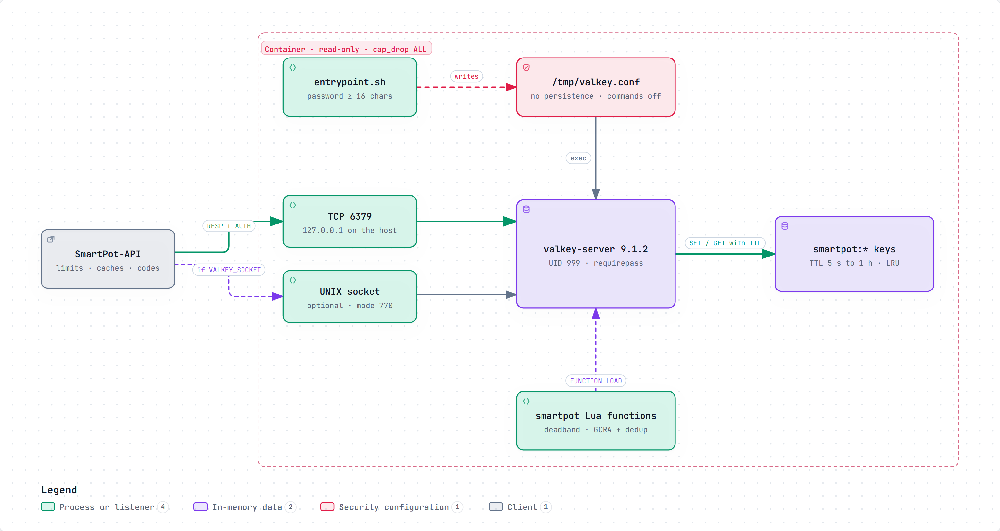
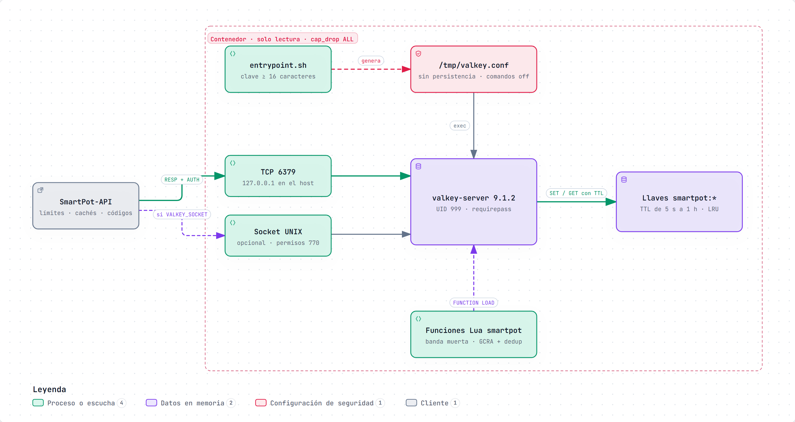

# SmartPot-Cache · Interactive Diagrams

[English](#english) | [Español](#español)

---

## English

Each diagram is a self-contained HTML page that works offline. Download it and open it in a browser to zoom, search nodes, trace a path and jump to the exact source lines on GitHub. The PNG preview is the light-theme render of the same diagram.

### 1. Container Architecture

What runs inside the read-only `smartpot-cache` container: `entrypoint.sh` rejects passwords shorter than 16 characters and writes `/tmp/valkey.conf` without persistence and with the administrative commands disabled, then `valkey-server` listens on TCP 6379 and, when `VALKEY_SOCKET` points to a writable volume, on a UNIX socket with mode 770. SmartPot-API stores its ephemeral `smartpot:*` keys with a TTL, and the `smartpot` Lua library (deadband and GCRA rate limiting with deduplication) is preloaded with `FUNCTION LOAD REPLACE`.

- Interactive: [English](SmartPot_Cache_A1_Container_Architecture.en.html) · [Spanish](SmartPot_Cache_A1_Container_Architecture.es.html)
- Sources: `entrypoint.sh`, `Dockerfile`, `compose.yaml`, `lua/smartpot_functions.lua` and `README.md` at commit `a7a87a7`.

---

## Español

Cada diagrama es una página HTML autocontenida que funciona sin conexión. Descárgala y ábrela en un navegador para ampliar, buscar nodos, seguir un recorrido y saltar a las líneas exactas del código en GitHub. La vista previa PNG es el mismo diagrama en tema claro.

### 1. Arquitectura del contenedor

Qué corre dentro del contenedor de solo lectura `smartpot-cache`: `entrypoint.sh` rechaza claves de menos de 16 caracteres y escribe `/tmp/valkey.conf` sin persistencia y con los comandos administrativos deshabilitados; después `valkey-server` escucha en TCP 6379 y, si `VALKEY_SOCKET` apunta a un volumen escribible, en un socket UNIX con permisos 770. SmartPot-API guarda sus llaves efímeras `smartpot:*` con TTL, y la librería Lua `smartpot` (banda muerta y límite de tasa GCRA con deduplicación) queda precargada con `FUNCTION LOAD REPLACE`.

- Interactivo: [inglés](SmartPot_Cache_A1_Container_Architecture.en.html) · [español](SmartPot_Cache_A1_Container_Architecture.es.html)
- Fuentes: `entrypoint.sh`, `Dockerfile`, `compose.yaml`, `lua/smartpot_functions.lua` y `README.md` en el commit `a7a87a7`.

